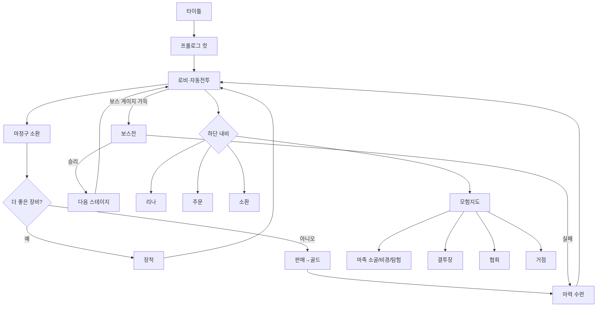

# 슬레이어즈: 붉은 마도사전 — UX 설계서 (팬메이드 비공식)
> 화룡전의 '시스템 구조'만 참고했습니다. 아트·코드·텍스트는 복사하지 않았고, 슬레이어즈 공식 아트도 쓰지 않았습니다. 그림은 모두 직접 만든 SVG(`assets/`)입니다.

## 1. 리서치 요약 — 열혈강호: 화룡전 (세시소프트)
- 장르: SD 캐릭터 **방치형 RPG**. 메인 화면에서 자동 전투가 계속 이어지고, 적을 처치하거나 제한 시간 안에 보스를 잡으면 다음 스테이지로 넘어감 [1][3]
- 핵심 루프: **화룡구** 사용 → 8종 장비 랜덤 획득 + 경험치 → 더 좋은 장비 장착/나머지 판매. 레벨이 오르면 자동 소환과 등급 필터를 쓸 수 있음 [1][3][4]
- 성장: **경지**(골드로 공·방·체 강화. 경지 레벨이 화룡구 레벨업 조건) [3]. **동료**(레벨 공명 적용, 4인 편성, 같은 세력 3인 이상이면 보너스, 세력 간 상성 정파/사파/중립) [1][3]. **무공**(공명 없음, 각각 따로 레벨업) [1]. 유물·보물·**팔대기보** 뽑기 [1][5]
- 콘텐츠: 원작 기반 스테이지 1~10장. 난이도 일반→어려움→악몽→지옥→심연→종말 [1]. 도전(일일 비경 던전, 탐험 미니게임 '야밤의 밀회') [4]. 신지 소굴 던전 [5]. **영지** 건설·자원 생산 [1][5]. **문파**(협동 던전), **PvP** [5]. 지령(퀘스트)을 우선 수행 [3]
- 과금: 동료 소환 + 마일리지(선택/확정 소환권) [4]
- **불확실**: 정확한 화폐 이름과 개수, 하단 내비 구성, 펫·탈것·코스튬 유무, 길드전 세부 내용, 튜토리얼 흐름. 출처에서 확인되지 않아 목업에서는 일반적인 방치형 RPG 관례로 채웠습니다.

출처: [1] https://www.cstimes.com/news/articleView.html?idxno=678880 · [2] https://m.onestore.co.kr/v2/ko-kr/app/0001002415 · [3] https://www.bluestacks.com/ko/blog/game-guides/breaking-bad-the-legend-of/bbtl-beginners-guide-ko.html · [4] https://www.bluestacks.com/ko/blog/game-guides/breaking-bad-the-legend-of/bbtl-tips-tricks-ko.html · [5] https://www.ldcloud.net/ko/blog/yulgang-fire-dragon-tale-afk-guide

## 2. 시스템 매핑 (1:1)
| 화룡전 | 슬레이어즈판 |
|---|---|
| 한비광(주인공) | 리나 인버스 |
| 화룡구 | 마정구(🔮) — 장비 8종: 지팡이·망토·부적·반지·장화·보주·두건·벨트 |
| 경지(공/방/체) | 마력 수련 |
| 무공(개별 레벨업) | 주문: 파이어볼·프리즈 애로우·리커버리·드래곤 슬레이브·라그나 블레이드·기가 슬레이브 |
| 동료(공명, 4인) | 가우리·젤가디스·아멜리아·제로스 등 |
| 세력 정/사/중립 | 인간 왕국 / 마족 / 용족·엘프 |
| 유물·팔대기보 | 마도구·클레어 바이블 사본(8대 비보) |
| 영지 | 리나의 거점(여관·마도구점·연구실) |
| 문파 | 마도사 협회(길드) |
| 신지 소굴 | 마족 소굴 던전 |
| 일일 비경 / 탐험 | 일일 비경 / 미니게임 '도적단 소탕 질주' |
| PvP | 결투장 |
| 지령 | 의뢰 게시판 |
| 1~10장 스테이지 | 아틀라스→세이룬→사이라그→마족의 숲→… (난이도 6단계 그대로) |

**스토리 개요**: 천재 미소녀 마도사 리나는 도적단을 털다가 '붉은 사본'을 손에 넣는다. 사본을 노리는 마족 장군들, 그리고 길에서 만난 동료들과 함께 세계 각지를 떠돌며 사본에 숨은 금단의 주문의 비밀을 쫓는다. 장마다 마족 보스를 쓰러뜨리고, 마지막에는 '기가 슬레이브'를 손에 넣을지 선택하게 된다.

## 3. 화면 목록
| # | 화면 | 화룡전 대응 | 핵심 요소 |
|---|---|---|---|
| 01 | 타이틀/로그인 | 타이틀 | 키아트, 게스트·구글 로그인 |
| 02 | 로비 | 메인(자동 전투) | HUD, 좌우 메뉴, 방치 보상, 보스 도전 |
| 03 | 보스전 | 보스 스테이지 | 보스 HP·제한시간, 주문 쿨타임, AUTO/배속 |
| 04 | 리나 | 캐릭터·내공 수련 | 장비 6슬롯, 마력 수련, 동료 |
| 05 | 주문서 | 무공 | 장착 4칸, 궁극기, 강화 |
| 06 | 소환 | 뽑기 | 마정구 소환, 천장 카운터 |
| 07 | 모험 지도 | 스테이지 맵 | 양피지 월드맵 위 경로 노드, 별 3개 |
| 08 | 영지 | 장원/거점 | 건물 레벨, 생산 타이머, 가속/수확 |
| 09 | 마도사 협회 | 문파 | 협동 토벌 보스, 기부, 회원 목록 |
| 10 | 투기장 | 비무/PvP | 내 순위·리그, 상대 목록(전투력), 도전권 |
| 11 | 상점 | 상점 | 한정 패키지, 패키지 3종, 일일 상점, 탭 |
| 12 | 일일 지령 | 일일 임무 | 활약도 상자, 진행도·보상, 받기/이동 |
| — | 설정 | 설정 | (미제작) |

## 4. 화면 흐름

## 5. 핵심 루프
전투(방치) → 골드·마정구 → 소환 → 장착/판매 → 수련·주문 강화 → 더 깊은 스테이지 → 오프라인 보상. 하루 단위로는 의뢰, 비경, 거점 수확, 결투장을 돌림.

## 6. 첫 10분 (FTUE)
0:00 타이틀 → 게스트 시작 · 0:30 프롤로그 4컷(도적단 습격) · 1:00 자동 전투 시작, 파이어볼 손가락 안내 · 2:00 마정구 첫 소환 → 장착 안내 · 3:00 판매 → 골드 → 마력 수련 1회 · 4:00 1-5 첫 보스, 드래곤 슬레이브 맛보기 연출 · 5:30 가우리 합류(동료 편성) · 7:00 의뢰 게시판 열림 · 8:00 자동 소환 해금 · 9:00 무료 10연 소환 · 10:00 모험 지도 열림 + 오프라인 보상 안내

## 7. 내비게이션 구조
상단 HUD(프로필·전투력·골드/보석/마정구) / 하단 5탭: 로비 · 리나 · 주문 · 소환 · 모험. 거점·결투장·협회·의뢰는 로비의 바로가기 칩과 모험 탭 안에 둠.
